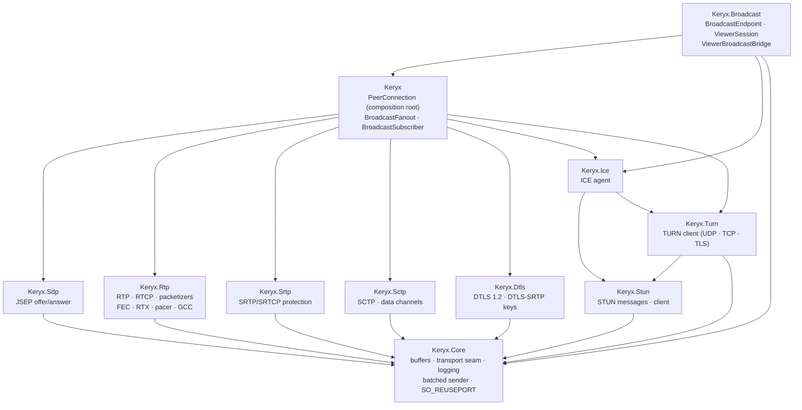
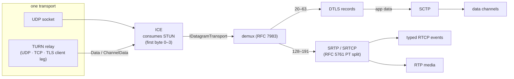
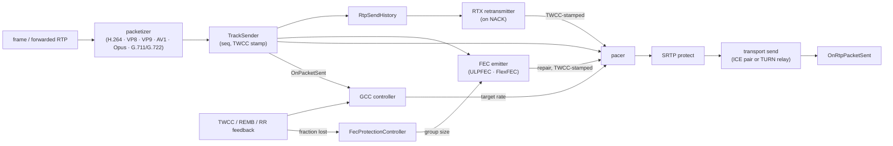

# Keryx architecture

Keryx is a strictly layered stack. Every protocol layer is its own assembly and NuGet package,
depends only on `Keryx.Core` (plus `Keryx.Stun` for `Keryx.Turn`, and `Keryx.Stun` and `Keryx.Turn` for `Keryx.Ice`), and is testable in isolation.
The `Keryx` package is the composition root that wires them into an `RTCPeerConnection`-style API.

`Keryx.Broadcast` is an optional package on top of the composition root: it owns the shared
sockets and per-viewer sessions. The fan-out primitives themselves (`BroadcastFanout`,
`BroadcastSubscriber`) live in `Keryx`, because they are built from `RtpForwarder` and the SRTP
encrypt context.

## The wire path

At runtime the layers stack differently than the compile-time graph. Everything multiplexes over
one transport owned by the ICE agent (BUNDLE + rtcp-mux): a UDP socket, or a TURN relay reached
over UDP, TCP or TLS:

The send path is the same stack in reverse, with the sender-side machinery in front of SRTP:

Media, RTX and FEC repair packets all draw transport-wide sequence numbers from one space and are
reported to the congestion controller as they are stamped, so GCC's send history and the pacer
account for repair traffic. The pacer exists only when congestion control is enabled; without it
packets go straight to SRTP. `OnRtpPacketSent` is raised after the datagram has been handed to the
transport (the wire exit), not when the frame is queued. A packet that failed to send is not
reported.

The broadcast path replaces the per-connection socket for a viewer. `BroadcastEndpoint` binds a pool
of UDP sockets to one port (`SO_REUSEPORT` on Linux, one socket elsewhere) and routes inbound
datagrams to a `ViewerSession` by 5-tuple, learned from the viewer's first STUN Binding request.
ICE, DTLS and SRTP keys stay per viewer. `ViewerBroadcastBridge` turns a connected session into a
`BroadcastSubscriber`, so `BroadcastFanout` can encrypt for many viewers in parallel and
`BroadcastEndpoint.SendBatch` flushes the result with `sendmmsg` (`BatchedDatagramSender` in
`Keryx.Core`), one batch per shard.

The seam between layers is `Keryx.Core.IDatagramTransport`: an unreliable, message-oriented,
bidirectional pipe. ICE exposes its selected candidate pair as one; DTLS consumes one and exposes
another (its decrypted application-data stream) to SCTP. This is what makes each layer testable
alone — the test suites drive DTLS and SCTP over in-memory transport doubles, including lossy and
reordering variants.

## Design rules

1. **No upward dependencies, no side dependencies** (exceptions: `Keryx.Ice -> Keryx.Stun`, `Keryx.Ice -> Keryx.Turn` and `Keryx.Turn -> Keryx.Stun`).
   SRTP does not reference RTP; it parses the 12-byte fixed header itself, because SRTP is a
   transform over wire bytes, not a media layer.
2. **Zero NuGet dependencies in shipping libraries.** The BCL is the only platform. Cryptographic
   primitives come from `System.Security.Cryptography`; hand-rolled ciphers are forbidden.
   Test projects may use xunit / FluentAssertions.
3. **Wire parsing never throws on hostile input.** Truncation surfaces as `ByteBufferException`
   from the shared readers and is translated into a clean rejection (`TryParse` returning false,
   a dropped packet, a logged warning) at the protocol boundary.
4. **Typed events over raw packets.** The API exposes what the application means to consume —
   `OnPictureLossIndication`, not an RTCP compound packet to grep through.

See `docs/layers/` for per-layer design notes and the simplifications each layer currently makes.
